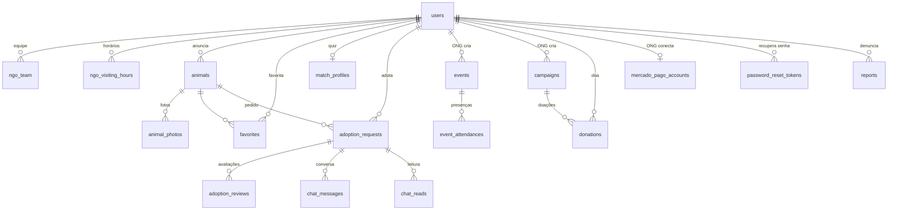

# AUcolher — O que falta no backend

Esta pasta é o pacote para o parceiro de backend: tudo o que ainda falta implementar na API e no banco, um contrato por módulo. O que já está pronto fica em `../contratos-prontos/`, só como referência.

**Como o front espera cada entrega:** a chamada da API de cada módulo já está escrita no front, atrás de uma flag `VITE_USE_MOCK_*`. Enquanto a rota não existe, a flag fica ligada e um "servidor falso" no `localStorage` responde no lugar, com os mesmos DTOs. Quando o módulo for entregue, o front põe a flag em `false` no `.env` e passa a usar a API. Por isso **nomes, formatos, códigos de status e mensagens precisam bater exatamente com os contratos.**

Os contratos seguem sempre o mesmo padrão:
- regras → DTOs → endpoints → notas de Spring → SQL → o que muda no front;
- rotas, campos e enums em inglês;
- erros no `ErrorResponseDTO`, com a frase pronta em `message` (o front mostra direto).

## 1. Arquivos desta pasta

| Arquivo | O que tem |
|---|---|
| `README.md` | Este mapa: situação, ordem, migrações, variáveis de ambiente, riscos e checklist |
| `api-campanhas-doacoes.md` | Campanhas e doações por PIX, mais a parte delas no admin e na moderação (**implementado**, menos o PIX real) |
| `api-mercado-pago-ongs.md` | Conexão da conta Mercado Pago de cada ONG (OAuth), PIX com o token da ONG e webhook |
| `api-senha.md` | Recuperar e alterar a senha pelo link do e-mail, derrubando as sessões |
| `api-chat.md` | Chat dos pedidos de adoção no banco, com polling e mensagens de sistema |
| `api-login-google.md` | Entrar com o Google: **já implementado** (back e front); só o fluxo, as variáveis e como criar as credenciais |
| `plano-front-api-pronta.md` | O plano do front para deixar cada módulo pronto para ligar na API |

## 2. Onde estamos

| Módulo | Tabelas | Backend | Front | Contrato |
|---|---|---|---|---|
| Contas e login (pessoa, ONG, admin) | `users`, `ngo_team`, `ngo_visiting_hours` | ✅ pronto | API | README do backend |
| Entrar com o Google | (`users`) | ✅ pronto | API (botão com `VITE_GOOGLE_LOGIN=true`) | `api-login-google.md` |
| Animais e favoritos | `animals`, `animal_photos`, `favorites` | ✅ pronto | API | README do backend |
| AUmatch | `match_profiles` | ✅ pronto | API | `contratos-prontos/api-aumatch.md` |
| Pedidos de adoção e avaliações | `adoption_requests`, `adoption_reviews` | ✅ pronto | API | `contratos-prontos/api-adocao.md` |
| Devolução, repasse e taxa de reabandono | (`adoption_requests`, `animals`) | ✅ pronto | API | `contratos-prontos/api-devolucao-reabandono.md` |
| Eventos e presenças | `events`, `event_attendances` | ✅ pronto | API | `contratos-prontos/api-eventos.md` |
| Perfil público e banner da ONG | (`users`) | ✅ pronto | API | `contratos-prontos/api-perfil-ong.md` |
| Painel do admin | — | ✅ pronto (campanhas e números de doação inclusos) | API | `contratos-prontos/api-admin.md` |
| Denúncias e moderação | `reports` | ✅ pronto (remoção de campanha inclusa) | API | `contratos-prontos/api-denuncias-moderacao.md` |
| Excluir conta | `users.deleted_at` | ✅ pronto | API | `contratos-prontos/api-exclusao-conta.md` |
| **Campanhas e doações (PIX)** | `campaigns`, `donations` | ✅ pronto, **menos o PIX real** (token único provisório) | API | `api-campanhas-doacoes.md` |
| **Conta Mercado Pago da ONG** | `mercado_pago_accounts` | ❌ falta | a fazer | `api-mercado-pago-ongs.md` |
| **Senha** | `password_reset_tokens` + `users.password_changed_at` | ❌ falta | mock (`VITE_USE_MOCK_SENHA`) | `api-senha.md` |
| **Chat** | `chat_messages`, `chat_reads` | ❌ falta | mock (`VITE_USE_MOCK_CHAT`) | `api-chat.md` |

## 3. Ordem sugerida

0. **Teste no sandbox do Mercado Pago** (`api-mercado-pago-ongs.md` §6): OAuth de um vendedor de teste, PIX criado com o token dele e o pagamento confirmado. O resultado decide entre o contrato e o plano B (§6 deste arquivo). **Ainda falta:** não há credenciais de teste.
1. ~~Campanhas e doações~~ (migração 007): **feito**, com a parte do admin e da moderação (`api-campanhas-doacoes.md` §7). Falta a **conta Mercado Pago** (009): até lá, o PIX usa um token único provisório.
2. **Senha** (010).
3. **Chat** (011).
4. ~~Excluir conta~~ (migração 013): **feito** (`contratos-prontos/api-exclusao-conta.md`). Quando a 009, a 010 e a 011 chegarem, a exclusão precisa apagar também a conta Mercado Pago, os links de senha e as marcas de leitura do chat (§1 do contrato).

**Opcional:** o e-mail de aviso "senha alterada" (`api-senha.md` §1).

## 4. Migrações

**Já aplicadas no `aucolher_db`:** 001 a 008, 012, 014, 015 e 016. A **013** (exclusão de conta, `sql/migrations/013_account_deletion.sql` no backend) está pronta e precisa ser aplicada no banco antes de subir a API nova.

**Faltam:**

| Nº | Arquivo | Conteúdo | SQL em |
|---|---|---|---|
| 009 | `009_mercado_pago_accounts.sql` | `mercado_pago_accounts` | `api-mercado-pago-ongs.md` §8 |
| 010 | `010_password_security.sql` | `users.password_changed_at`, `password_reset_tokens` | `api-senha.md` §7 |
| 011 | `011_chat.sql` | `chat_messages`, `chat_reads` | `api-chat.md` §5 |

**Dependências que exigem cuidado:**
- **A 009 vem depois da 007:** `mercado_pago_accounts` não depende de `campaigns`, mas a regra "sem conta conectada não há campanha" precisa das duas.
- **A CHECK de `chat_messages.system_event`** já nasce com os 6 eventos, incluindo `ANIMAL_RETURNED` e `ANIMAL_REHOMED` (a devolução, migração 012, já existe).
- **A CHECK de `adoption_requests.cancel_reason` não deve ser recriada.** A 014 já aceita `ACCOUNT_DELETED`, `ACCOUNT_BANNED` e `LISTING_REMOVED`. Recriá-la com menos valores quebraria a moderação.

**Padrão das migrações:**
- cabeçalho com o que muda e o comando `psql`;
- `BEGIN`/`COMMIT`;
- `IF NOT EXISTS`, e `DROP CONSTRAINT IF EXISTS` antes de recriar uma constraint;
- `COMMENT ON` nas colunas novas.

**Depois de cada migração:**
- atualizar o `sql/schema.sql`;
- atualizar a cópia do front, `docs/script_banco_aucolher.sql`;
- acrescentar a seção no README do backend.

## 5. Variáveis de ambiente novas (backend)

| Variável | Para quê | Exemplo |
|---|---|---|
| `FRONTEND_URL` | Montar o link de redefinição de senha, a volta do OAuth do Mercado Pago e a volta do login com o Google (este já em uso: `app.frontend-url`) | `http://localhost:5173` |
| `GOOGLE_CLIENT_ID` / `GOOGLE_CLIENT_SECRET` | Entrar com o Google, já em uso (`api-login-google.md` §6) | — |
| `MAIL_USERNAME` | Conta Gmail do projeto | `aucolher.app@gmail.com` |
| `MAIL_PASSWORD` | **Senha de app** do Gmail (não é a senha da conta) | `abcd efgh ijkl mnop` |
| `MP_CLIENT_ID` | ID da aplicação do AUcolher no Mercado Pago | `1234567890123456` |
| `MP_CLIENT_SECRET` | Secret da aplicação | — |
| `MP_REDIRECT_URI` | URL de retorno do OAuth, **igual** à cadastrada na aplicação do Mercado Pago | `https://api.../api/mercado-pago/oauth/callback` |
| `MP_WEBHOOK_SECRET` | Assinatura secreta dos webhooks (painel do Mercado Pago → Webhooks) | — |
| `MP_TOKEN_ENCRYPTION_KEY` | Chave AES de 32 bytes em Base64 para criptografar os tokens das ONGs | `openssl rand -base64 32` |
| `MP_TEST_TOKEN` | `true` em desenvolvimento: o OAuth gera credenciais de teste | `true` |

**Regras:**
- nada disso vai para o Git;
- sem `MAIL_*`, o link de senha sai **no log** da API, como o `AdminAccountInitializer` faz quando falta configuração;
- sem `MP_*`, a conexão do Mercado Pago responde 503 "Pagamentos indisponíveis no momento." e o resto do sistema funciona.

## 6. Riscos

| Risco | O que fazer |
|---|---|
| O PIX criado com o token OAuth da ONG não funciona, ou o pagamento não pode ser confirmado | O teste no sandbox decide. Se falhar, **plano B**: conta única da plataforma, com repasse às ONGs registrado no painel (regras §10.3). Avisar o front |
| O Mercado Pago não aceita `localhost` como URL de retorno do OAuth | Testar com a API publicada ou com um túnel (ngrok). O front segue com o mock enquanto isso |
| O e-mail do Gmail cai no spam | Assunto e texto simples, remetente com nome ("AUcolher"). A página de recuperação já avisa para olhar o spam |

## 7. O banco depois de tudo

19 tabelas. ✱ = nova.

| Tabela | Para quê |
|---|---|
| `users` | contas (pessoa, ONG, admin); ganha `password_changed_at` (010); `deleted_at` (013) já existe |
| `ngo_team` | equipe do perfil da ONG |
| `ngo_visiting_hours` | horário de visitas da ONG |
| `animals` | anúncios |
| `animal_photos` | até 4 fotos por anúncio |
| `favorites` | animais favoritados |
| `match_profiles` | respostas do quiz do AUmatch |
| `adoption_requests` | pedidos de adoção, com devolução e repasse |
| `adoption_reviews` | avaliações depois da adoção |
| `events` | eventos das ONGs |
| `event_attendances` | presenças confirmadas |
| `reports` | denúncias de anúncios e perfis |
| ✱ `campaigns` | campanhas de doação |
| ✱ `donations` | doações via PIX |
| ✱ `mercado_pago_accounts` | conta Mercado Pago de cada ONG (tokens criptografados) |
| ✱ `password_reset_tokens` | links de redefinição de senha (só o hash) |
| ✱ `chat_messages` | mensagens do chat de cada pedido (pessoa ou sistema) |
| ✱ `chat_reads` | até onde cada parte leu cada conversa |

`reports.target_id` aponta para um animal **ou** uma conta, conforme o `target_type`. Por isso não tem chave estrangeira e não aparece no diagrama.

## 8. Fora do escopo

- **`GET /api/users/me`**.
- **Upload de imagens:** foto de perfil, fotos dos animais, capas e o banner continuam como data URL dentro do JSON.
- **Estatísticas públicas da home** (`GET /api/stats/public`): a home calcula a partir da vitrine.
- **Notificações:** foram removidas (regras §11).
- **Avaliações** não viram alvo de denúncia, e as de contas banidas continuam aparecendo.
- **Telefone/WhatsApp:** saiu do sistema e não deve voltar (`contratos-prontos/api-perfil-ong.md` §1).

## 9. Checklist de cada entrega

- [ ] Migração numerada + `sql/schema.sql` + seção no README do backend.
- [ ] Entidades, enums e DTOs com os **nomes exatos** do contrato (`@JsonProperty("isX")` nos booleanos).
- [ ] Regras no `SecurityConfig`: rotas fixas antes das genéricas, e rotas públicas só onde o contrato manda.
- [ ] Mensagens de erro **iguais** às dos contratos, porque o front mostra o `message` direto.
- [ ] Testes de unidade das regras (no padrão do `AdoptionRequestServiceTest`) e um teste HTTP de ponta a ponta num banco descartável.
- [ ] Avisar o front quando a rota estiver no ar e qual flag pode ser desligada.
