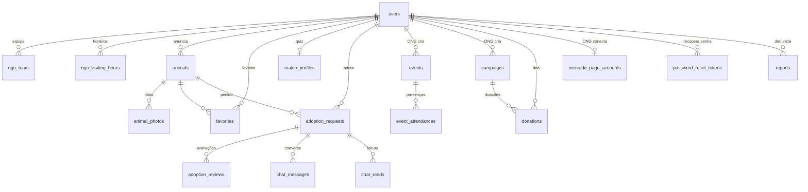

# AUcolher — Entrega final do backend

Esta pasta foi o pacote para o parceiro de backend: um contrato por módulo que ainda faltava na API e no banco. **Hoje todos estão implementados** (seção 2), e os contratos ficam como referência de nomes, formatos e mensagens. Os módulos que ficaram prontos antes estão em `../contratos-prontos/`.

**Como o front espera cada módulo:** o front usa só a API, sem mocks nem flags `VITE_USE_MOCK_*`. Se a rota de um módulo não responde, aquela parte da tela fica vazia ou mostra um erro, e o resto do site segue normal. Por isso **nomes, formatos, códigos de status e mensagens precisam bater exatamente com os contratos**, inclusive em mudanças futuras.

Os contratos seguem sempre o mesmo padrão:
- regras → DTOs → endpoints → notas de Spring → SQL → o que muda no front;
- rotas, campos e enums em inglês;
- erros no `ErrorResponseDTO`, com a frase pronta em `message` (o front mostra direto).

## 1. Arquivos desta pasta

| Arquivo | O que tem |
|---|---|
| `README.md` | Este mapa: situação, ordem, migrações, variáveis de ambiente, riscos e checklist |
| `api-campanhas-doacoes.md` | Campanhas e doações por PIX, mais a parte delas no admin e na moderação (**implementado**) |
| `api-mercado-pago-ongs.md` | Conexão da conta Mercado Pago de cada ONG (OAuth), PIX com o token da ONG, webhook e consulta periódica (**implementado e testado com PIX real**) |
| `roteiro-banca-mercado-pago.md` | Roteiro da demonstração das doações na banca, com checklist, perguntas prováveis e plano de contingência |
| `api-senha.md` | Recuperar e alterar a senha pelo link do e-mail, derrubando as sessões (**implementado**) |
| `api-chat.md` | Chat dos pedidos de adoção no banco, com polling e mensagens de sistema (**implementado**) |
| `api-login-google.md` | Entrar com o Google: **já implementado** (back e front); só o fluxo, as variáveis e como criar as credenciais |
| `plano-front-api-pronta.md` | O plano do front para deixar cada módulo pronto para ligar na API |

## 2. Onde estamos

| Módulo | Tabelas | Backend | Front | Contrato |
|---|---|---|---|---|
| Contas e login (pessoa, ONG, admin) | `users`, `ngo_team`, `ngo_visiting_hours` | ✅ pronto | API | README do backend |
| Entrar com o Google | (`users`) | ✅ pronto | API | `api-login-google.md` |
| Animais e favoritos | `animals`, `animal_photos`, `favorites` | ✅ pronto | API | README do backend |
| AUmatch | `match_profiles` | ✅ pronto | API | `contratos-prontos/api-aumatch.md` |
| Pedidos de adoção e avaliações | `adoption_requests`, `adoption_reviews` | ✅ pronto | API | `contratos-prontos/api-adocao.md` |
| Devolução, repasse e taxa de reabandono | (`adoption_requests`, `animals`) | ✅ pronto | API | `contratos-prontos/api-devolucao-reabandono.md` |
| Eventos e presenças | `events`, `event_attendances` | ✅ pronto | API | `contratos-prontos/api-eventos.md` |
| Perfil público e banner da ONG | (`users`) | ✅ pronto | API | `contratos-prontos/api-perfil-ong.md` |
| Painel do admin | — | ✅ pronto (campanhas e números de doação inclusos) | API | `contratos-prontos/api-admin.md` |
| Denúncias e moderação | `reports` | ✅ pronto (remoção de campanha inclusa) | API | `contratos-prontos/api-denuncias-moderacao.md` |
| Excluir conta | `users.deleted_at` | ✅ pronto | API | `contratos-prontos/api-exclusao-conta.md` |
| **Campanhas e doações (PIX)** | `campaigns`, `donations` | ✅ pronto, com PIX real (testado em 15 e 16/11/2026) | API | `api-campanhas-doacoes.md` |
| **Conta Mercado Pago da ONG** | `mercado_pago_accounts` | ✅ pronto: o PIX sai com o token da ONG e cai na conta dela | API | `api-mercado-pago-ongs.md` |
| **Senha** | `password_reset_tokens` + `users.password_changed_at` | ✅ pronto | API | `api-senha.md` |
| **Chat** | `chat_messages`, `chat_reads` | ✅ pronto | API | `api-chat.md` |

## 3. Ordem de entrega (concluída)

0. ~~Teste do Mercado Pago~~: **feito em 15 e 16/11/2026**, com PIX real e a conta do João conectada como ONG. O contrato valeu; o plano B (§6) não foi necessário. O que o teste confirmou está em `api-mercado-pago-ongs.md` §5.1 a §5.3.
1. ~~Campanhas e doações~~ (migração 007) e ~~conta Mercado Pago~~ (009): **feito**, com a parte do admin e da moderação (`api-campanhas-doacoes.md` §7), a tela de conexão no painel da ONG e o PIX com o token de cada ONG.
2. ~~Senha~~ (010): **feito** (`api-senha.md`).
3. ~~Chat~~ (011): **feito** (`api-chat.md`).
4. ~~Excluir conta~~ (migração 013): **feito** (`contratos-prontos/api-exclusao-conta.md`). Os links de senha (010), as marcas de leitura do chat (011) e a conta Mercado Pago (009) também são apagados.

**Opcional:** o e-mail de aviso "senha alterada" (`api-senha.md` §1).

## 4. Migrações

**Já existem no backend** (`sql/migrations/`): todas, da 001 à 017. Não falta nenhuma.

**Onde estão aplicadas:**
- **`aucolher_db` local:** é o banco em uso desde 23/11/2026. Tem todas, e os dados foram copiados do Aiven nesse dia (dump restaurado; as 18 tabelas conferidas, com as mesmas contagens).
- **Aiven:** tem todas também (`backend/docs/guia-banco-aiven.md`). Ficou como cópia de segurança de 23/11/2026: o que for cadastrado depois no banco local não aparece nele.

**Cuidado em migrações novas:**
- **A CHECK de `adoption_requests.cancel_reason` não deve ser recriada.** A 014 já aceita `ACCOUNT_DELETED`, `ACCOUNT_BANNED` e `LISTING_REMOVED`. Recriá-la com menos valores quebraria a moderação.

**Padrão das migrações:**
- cabeçalho com o que muda e o comando `psql`;
- `BEGIN`/`COMMIT`;
- `IF NOT EXISTS`, e `DROP CONSTRAINT IF EXISTS` antes de recriar uma constraint;
- `COMMENT ON` nas colunas novas.

**Depois de cada migração:**
- atualizar o `sql/schema.sql`;
- atualizar a cópia do front, `docs/script_banco_aucolher.sql`;
- acrescentar a seção no README do backend.

## 5. Variáveis de ambiente novas (backend)

| Variável | Para quê | Exemplo |
|---|---|---|
| `FRONTEND_URL` | Montar o link de redefinição de senha, a volta do OAuth do Mercado Pago e a volta do login com o Google (este já em uso: `app.frontend-url`) | `http://localhost:5173` |
| `GOOGLE_CLIENT_ID` / `GOOGLE_CLIENT_SECRET` | Entrar com o Google, já em uso (`api-login-google.md` §6) | — |
| `MAIL_USERNAME` | Conta Gmail do projeto | `aucolher.app@gmail.com` |
| `MAIL_PASSWORD` | **Senha de app** do Gmail, com 16 letras e sem espaços (não é a senha da conta) | `abcdefghijklmnop` |
| `MP_CLIENT_ID` | ID da aplicação do AUcolher no Mercado Pago | `1234567890123456` |
| `MP_CLIENT_SECRET` | Secret da aplicação | — |
| `MP_REDIRECT_URI` | URL de retorno do OAuth, **igual** à cadastrada na aplicação do Mercado Pago | `https://api.../api/mercado-pago/oauth/callback` |
| `MP_WEBHOOK_SECRET` | Assinatura secreta dos webhooks, do modo **Produção** (Configuração de webhooks), copiada depois do último Salvar | — |
| `MP_TOKEN_ENCRYPTION_KEY` | Chave AES de 32 bytes em Base64 para criptografar os tokens das ONGs | `openssl rand -base64 32` |
| `MP_STATE_SECRET` | Assina o `state` do OAuth. Opcional: sem ela, usa a chave do JWT | `openssl rand -base64 32` |
| `MP_TEST_TOKEN` | Deixar `false`: com `true` o OAuth entrega um token `TEST-`, que a criação do PIX recusa (401) | `false` |
| `MP_SANDBOX` | Deixar `false` com conta real: com `true` o pagador vai como "APRO" e a cobrança continua real | `false` |
| `DONATION_RECONCILE_DELAY_MS` | Intervalo da consulta periódica dos PIX pendentes | `60000` |

**Regras:**
- nada disso vai para o Git;
- sem `MAIL_*`, o link de senha sai **no log** da API;
- se o Gmail recusar o envio, a tela continua dizendo que enviou: o erro só aparece no log da API (`Falha ao enviar o e-mail`);
- sem `MP_*`, a conexão do Mercado Pago responde 503 "Pagamentos indisponíveis no momento." e o resto do sistema funciona.

## 6. Riscos

| Risco | O que fazer |
|---|---|
| ~~O PIX criado com o token OAuth da ONG não funciona~~ | **Resolvido:** funcionou com PIX real em 15/11/2026. O plano B (conta única da plataforma) não foi necessário |
| ~~O Mercado Pago não aceita `localhost` como URL de retorno do OAuth~~ | **Resolvido** com um túnel (ngrok, domínio fixo). Publicado, o site só troca as URLs |
| O webhook passa a recusar as notificações (401) depois de alguém clicar em Salvar no painel, que pode trocar o segredo | Copiar o segredo de novo para `MP_WEBHOOK_SECRET` e reiniciar. Até lá, a consulta periódica aprova os PIX pagos em até 1 minuto |
| A conta da ONG não tem chave Pix | O PIX falha com 402 `processing_error`. O cartão de conectar já avisa que a conta precisa de chave Pix |
| O e-mail do Gmail cai no spam | Assunto e texto simples, remetente com nome ("AUcolher"). A página de recuperação já avisa para olhar o spam |

## 7. O banco depois de tudo

18 tabelas, todas já criadas.

| Tabela | Para quê |
|---|---|
| `users` | contas (pessoa, ONG, admin), com `password_changed_at` (010) e `deleted_at` (013) |
| `ngo_team` | equipe do perfil da ONG |
| `ngo_visiting_hours` | horário de visitas da ONG |
| `animals` | anúncios |
| `animal_photos` | até 4 fotos por anúncio |
| `favorites` | animais favoritados |
| `match_profiles` | respostas do quiz do AUmatch |
| `adoption_requests` | pedidos de adoção, com devolução e repasse |
| `adoption_reviews` | avaliações depois da adoção |
| `events` | eventos das ONGs |
| `event_attendances` | presenças confirmadas |
| `reports` | denúncias de anúncios e perfis |
| `campaigns` | campanhas de doação |
| `donations` | doações via PIX |
| `mercado_pago_accounts` | conta Mercado Pago de cada ONG (tokens criptografados) |
| `password_reset_tokens` | links de redefinição de senha (só o hash) |
| `chat_messages` | mensagens do chat de cada pedido (pessoa ou sistema) |
| `chat_reads` | até onde cada parte leu cada conversa |

`reports.target_id` aponta para um animal **ou** uma conta, conforme o `target_type`. Por isso não tem chave estrangeira e não aparece no diagrama.

## 8. Fora do escopo

- **`GET /api/users/me`**.
- **Upload de imagens:** foto de perfil, fotos dos animais, capas e o banner continuam como data URL dentro do JSON.
- **Estatísticas públicas da home** (`GET /api/stats/public`): a home calcula a partir da vitrine.
- **Notificações:** foram removidas (regras §11).
- **Avaliações** não viram alvo de denúncia, e as de contas banidas continuam aparecendo.
- **Telefone/WhatsApp:** saiu do sistema e não deve voltar (`contratos-prontos/api-perfil-ong.md` §1).

## 9. Checklist de cada entrega

- [ ] Migração numerada + `sql/schema.sql` + seção no README do backend.
- [ ] Entidades, enums e DTOs com os **nomes exatos** do contrato (`@JsonProperty("isX")` nos booleanos).
- [ ] Regras no `SecurityConfig`: rotas fixas antes das genéricas, e rotas públicas só onde o contrato manda.
- [ ] Mensagens de erro **iguais** às dos contratos, porque o front mostra o `message` direto.
- [ ] Testes de unidade das regras (no padrão do `AdoptionRequestServiceTest`) e um teste HTTP de ponta a ponta num banco descartável.
- [ ] Avisar o front quando a rota estiver no ar, para testar a tela contra ela.
