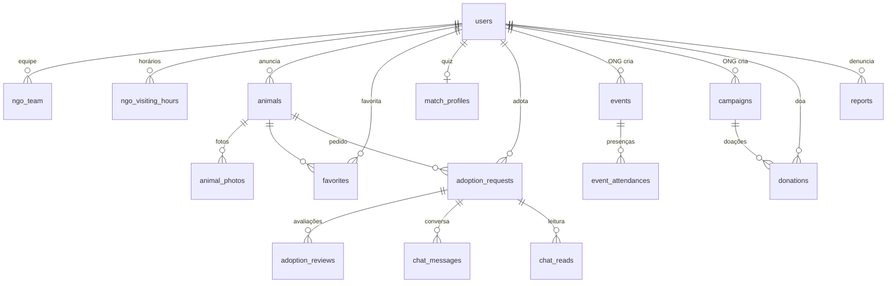

# AUcolher — Plano: o que falta no backend

> Escrito em 13/10/2026, para o parceiro de backend. O frontend está trocando o `localStorage` pelo banco real, módulo por módulo. Este arquivo é o mapa:
> - o que já está no banco;
> - o que está em andamento;
> - o que falta, com o contrato de cada parte em um `.md` próprio.
>
> Os contratos seguem o formato do `api-campanhas-eventos.md`: regras → DTOs → endpoints → notas de Spring → SQL. Rotas, campos e enums ficam em inglês, e os erros vêm no `ErrorResponseDTO`, com a frase pronta em `message`.

## 1. Onde estamos

| Módulo | Tabelas | Backend | Front hoje | Contrato |
|---|---|---|---|---|
| Contas e login (pessoa, ONG, admin, Google) | `users`, `ngo_team`, `ngo_visiting_hours` | ✅ pronto | API | README do backend |
| Animais | `animals`, `animal_photos` | ✅ pronto | API | README do backend |
| Favoritos | `favorites` | ✅ pronto | API | README do backend |
| AUmatch | `match_profiles` | ✅ pronto | API | `api-aumatch.md` |
| Pedidos de adoção e avaliações | `adoption_requests`, `adoption_reviews` | ✅ pronto | API | `api-adocao.md` |
| Eventos e presenças | `events`, `event_attendances` | ✅ pronto | API (`VITE_USE_MOCK_EVENTOS=false`) | `api-campanhas-eventos.md` §1–5 |
| Perfil público | (`users`) | ✅ pronto | API | README do backend |
| **Campanhas e doações (PIX)** | `campaigns`, `donations` | 🔧 em andamento (parceiro) | mock (`VITE_USE_MOCK_CAMPANHAS`) | `api-campanhas-eventos.md` §6 |
| Banner da ONG | `users.cover_url` | ✅ pronto (migração 008, 15/10/2026) | API | `api-perfil-ong.md` |
| **Chat** | `chat_messages`, `chat_reads` | ❌ falta | `localStorage` | `api-chat.md` |
| **Admin: estatísticas e listas** | nenhuma tabela nova | ❌ falta (só existe `GET /api/admin/adoption-requests`) | mock (`VITE_USE_MOCK_ADMIN`) | `api-admin.md` |
| **Denúncias e moderação** | `reports` + ajustes em `animals`, `adoption_requests`, `events`, `campaigns` | ❌ falta | mock (`VITE_USE_MOCK_DENUNCIAS`, `VITE_USE_MOCK_ADMIN`) | `api-denuncias-moderacao.md` |

Hoje o `aucolher_db` tem 11 tabelas. Depois de tudo, terá 16 (§5).

## 2. O que falta, em poucas linhas

- **Banner da ONG** (`api-perfil-ong.md`): uma coluna `users.cover_url` só para ONG, aceita no `PUT /api/users/me` e devolvida no perfil. O mesmo arquivo avisa que o **telefone/WhatsApp saiu de vez** e não deve voltar.
- **Chat** (`api-chat.md`): as mensagens de cada pedido aceito vão para o banco, com o contador de não lidas. Hoje cada navegador tem a sua cópia, então **adotante e dono não veem as mensagens um do outro**. Funciona por polling (sem WebSocket). As mensagens de sistema ("entrega confirmada", "adoção concluída") passam a ser criadas pelo backend na troca de status.
- **Admin: estatísticas e listas** (`api-admin.md` §1–5): números e gráficos da Visão geral, e as listas de contas, animais, campanhas e eventos. São só consultas.
- **Denúncias e moderação** (`api-denuncias-moderacao.md`): denunciar anúncio ou perfil, o admin julgar (arquivar, banir, remover), banir e reativar contas, remover anúncio/campanha/evento, e o efeito cascata do banimento.

## 3. Ordem sugerida de entrega

0. **Campanhas e doações**: já está com você.
1. **Banner da ONG**: uma coluna, três DTOs e uma validação. Pequeno, bom para aquecer.
2. **Chat**: duas tabelas novas, quatro rotas e uma chamada a mais dentro do `AdoptionRequestService.changeStatus`. Não depende de mais nada e resolve o problema mais visível para o usuário (hoje o chat não funciona entre duas pessoas de verdade).
3. **Pacote admin** = `api-admin.md` + `api-denuncias-moderacao.md`, **entregues juntos**:
   - a mesma flag do front (`VITE_USE_MOCK_ADMIN`) liga as estatísticas e a moderação; entregando só metade, o front não consegue trocar;
   - vem **depois de campanhas**: as estatísticas somam doações, e a moderação remove campanhas (coluna `campaigns.removed_by_moderation`).

## 4. Migrações

**Numeração.** Os dois repositórios já divergiram:
- no seu, `004_events` e `005_match_profiles`;
- no nosso, `004_match_profiles`, `005_adoption_requests` e `006_events`.

Sugestão: seguir a numeração do nosso repositório a partir daqui. Combine antes de criar os arquivos.

> **Atualizado em 15/10/2026:** com as features novas, as migrações foram **renumeradas na ordem das sprints**. Chat passou para **011** e denúncias e moderação para **014**. A tabela completa (007 a 014) e as dependências estão em `entrega-final/README.md` §3. A tabela abaixo fica só como histórico.

| Nº (antigo) | Arquivo | Conteúdo | SQL em |
|---|---|---|---|
| 007 | `007_campaigns.sql` | `campaigns`, `donations` | `api-campanhas-eventos.md` §6.7 (você) |
| 008 | `008_ngo_cover.sql` | `users.cover_url` (+ apaga `telefone_whatsapp`, se existir) | `api-perfil-ong.md` §2.5 |
| ~~009~~ → 011 | `011_chat.sql` | `chat_messages`, `chat_reads` | `api-chat.md` §5 |
| ~~010~~ → 014 | `014_reports_moderation.sql` | `reports` + ajustes em `animals`, `adoption_requests`, `events`, `campaigns` | `api-denuncias-moderacao.md` §5 |

- A 014 altera `campaigns`, então precisa rodar depois da 007. Se a ordem mudar, mova o bloco de `campaigns` para a migração de campanhas.
- **Padrão das migrações**, igual às que já existem:
  - cabeçalho explicando o que muda e o comando `psql`;
  - `BEGIN`/`COMMIT`, `IF NOT EXISTS`, `DROP CONSTRAINT IF EXISTS` antes de recriar uma constraint;
  - `COMMENT ON` nas colunas novas.
- **Depois de cada migração:**
  - atualizar o `sql/schema.sql`;
  - atualizar a cópia do front, `docs/script_banco_aucolher.sql`;
  - acrescentar uma seção "#### ... (migração 00N)" no README do backend.

## 5. O banco depois de tudo

16 tabelas. ✱ = nova.

| Tabela | Para quê |
|---|---|
| `users` | contas (pessoa, ONG, admin); ganha `cover_url` (banner da ONG) |
| `ngo_team` | equipe do perfil da ONG |
| `ngo_visiting_hours` | horário de visitas da ONG |
| `animals` | anúncios; `status` ganha `REMOVED` (moderação) |
| `animal_photos` | até 4 fotos por anúncio |
| `favorites` | animais favoritados |
| `match_profiles` | respostas do quiz do AUmatch |
| `adoption_requests` | pedidos de adoção; `cancel_reason` ganha `ACCOUNT_BANNED` e `LISTING_REMOVED` |
| `adoption_reviews` | avaliações depois da adoção |
| `events` | eventos das ONGs; ganha `removed_by_moderation` |
| `event_attendances` | presenças confirmadas |
| ✱ `campaigns` | campanhas de doação; ganha `removed_by_moderation` |
| ✱ `donations` | doações via PIX |
| ✱ `chat_messages` | mensagens do chat de cada pedido (pessoa ou sistema) |
| ✱ `chat_reads` | até onde cada parte leu cada conversa |
| ✱ `reports` | denúncias de anúncios e perfis |

`reports.target_id` aponta para um animal **ou** uma conta, conforme o `target_type`. Por isso não tem chave estrangeira e não aparece no diagrama.

## 6. Fora do escopo por enquanto (decidido em 13/10)

Ficam registrados para depois, e não precisam de nada agora:

- ~~**Recuperar senha**, **trocar senha** e **excluir a própria conta**~~: entraram no escopo em 14/10. Contratos em `entrega-final/api-senha.md` e `entrega-final/api-exclusao-conta.md`.
- **`GET /api/users/me`**: continua fora.
- ~~**Histórico de reabandono**~~: entrou no escopo em 14/10, como retorno e repasse com o score congelado no pedido. Contrato em `entrega-final/api-devolucao-reabandono.md`.
- **Novo em 14/10:** a conta Mercado Pago de cada ONG (`entrega-final/api-mercado-pago-ongs.md`) muda o jeito de criar o PIX das campanhas.
- **Upload de imagens**: foto de perfil, fotos dos animais, capas e o banner continuam como data URL dentro do JSON.
- **Estatísticas públicas da home** (`GET /api/stats/public`): a home continua calculando a partir da vitrine.
- **Notificações**: foram removidas (regras §11).
- **Avaliações**: ficam como estão. Não viram alvo de denúncia, e as de contas banidas continuam aparecendo.

## 7. Checklist de cada entrega

- [ ] Migração numerada + `sql/schema.sql` + seção no README.
- [ ] Entidades, enums e DTOs com os **nomes exatos** do contrato (`@JsonProperty("isX")` nos booleans, como já é feito).
- [ ] Regras de segurança no `SecurityConfig`: rotas fixas antes das genéricas, como em `/animals/mine` e `/events/mine`.
- [ ] Mensagens de erro **iguais** às das tabelas dos contratos: o front mostra o `message` direto.
- [ ] Testes de unidade das regras e um teste HTTP de ponta a ponta num banco descartável.
- [ ] Avisar qual flag do front pode ser desligada (`VITE_USE_MOCK_*=false`).

## 8. Lado do front (lembrete para quem faz o front)

O que muda no front depois de cada entrega está no fim de cada contrato. Os pontos maiores:

- **Chat** (`api-chat.md` §6): trocar o `localStorage` por react-query com polling, tirar o `injectSystemMessage` e dar ao campo de texto `maxLength={1000}`.
- **Denúncias e moderação** (`api-denuncias-moderacao.md` §6):
  - desligar as duas flags;
  - tirar os filtros de moderação do mock das fachadas da API real;
  - um interceptor do 403 de conta suspensa no `api.js`.
- **Banner** (`api-perfil-ong.md` §3): ✅ feito em 15/10/2026 (branch `feature/banner-ong`). Campo em "Minha conta" da ONG, banner nítido no perfil público e a vitrine da home lendo o perfil real pelo id que vem dos animais e eventos da API.
